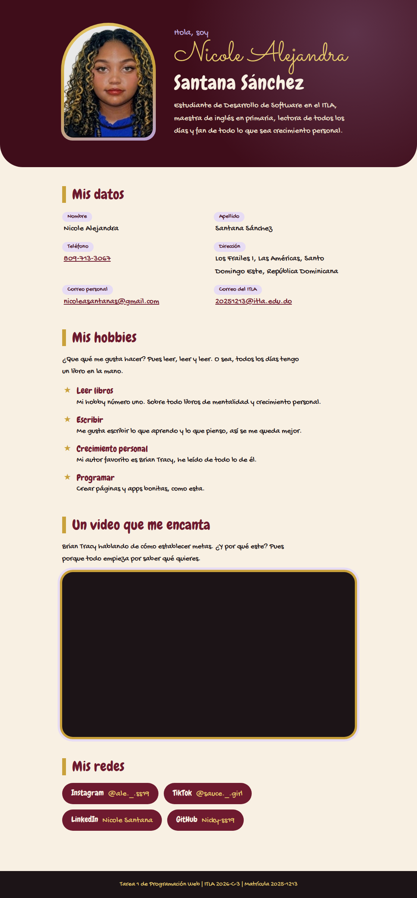

# Mi página web personal ✨

**Tarea 1 de Programación Web (ITLA, 2026-C-3)**
Hecha por Nicole Alejandra Santana Sánchez, matrícula 2025-1213.

Esta es mi página personal, hecha solo con HTML y CSS. Tiene mi foto, mi nombre y apellido, mi teléfono, mi dirección, mis correos, mis hobbies, los links a mis redes sociales y un video de YouTube que me encanta de Brian Tracy.

## Captura de pantalla



## ¿Qué tiene?

- Mi foto en un marco en forma de arco con borde dorado y lila.
- Mis datos: nombre, apellido, teléfono, dirección y mis dos correos. El teléfono y los correos son links, o sea que si les das clic te abren para llamar o escribir.
- Mis hobbies, que básicamente son leer, leer y leer 📚
- Un video de YouTube insertado con un `iframe`, que se mantiene en proporción 16:9 en cualquier pantalla.
- Links a mi Instagram, TikTok, LinkedIn y GitHub, que abren en otra pestaña.
- Colores vino, dorado, crema y lila, con letras tipo burbuja y cursiva de Google Fonts.
- Se adapta al celular.

## ¿Cómo está organizado?

```
pagina-personal/
├── index.html        → el contenido de la página
├── css/
│   └── estilos.css   → los colores, las letras y el diseño
├── img/
│   └── foto.jpg      → mi foto
├── captura.png
└── README.md
```

## ¿Cómo lo abro?

Solo descarga el repositorio y abre `index.html` en tu navegador.
